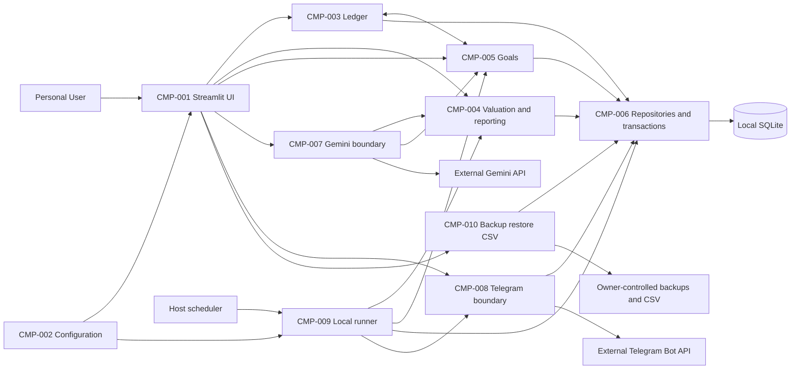
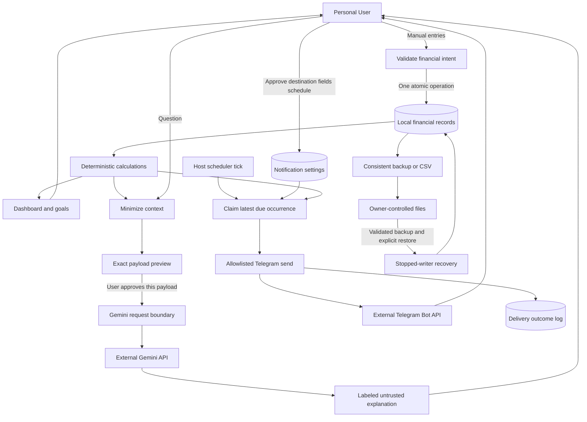
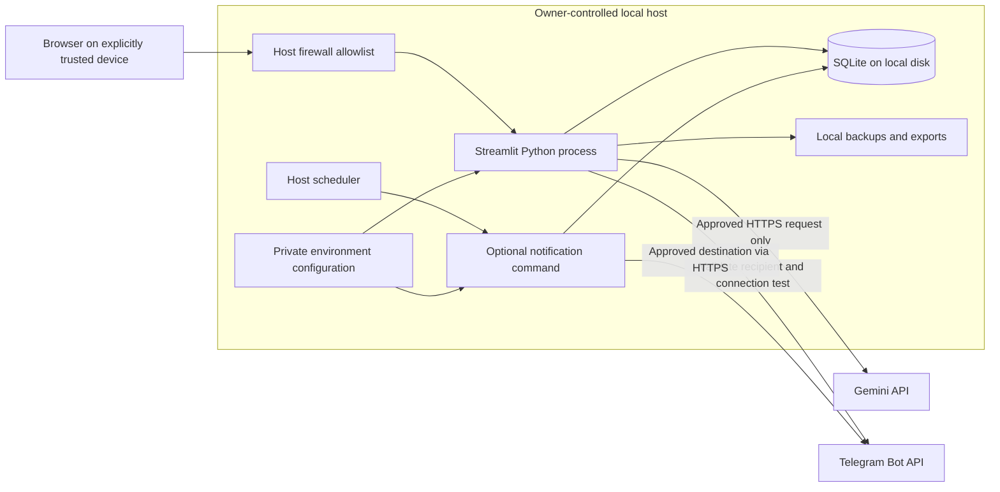

# Finance Tracker — Software Architecture

Status: Proposed design; all components below are **Planned**. The Charter stack and confirmed owner choices are inputs; this document does not describe existing application code. See [SRS](../requirements/SRS.md), [DATA_MODEL](DATA_MODEL.md), and [DECISION_LOG](../DECISION_LOG.md).

## 1. Architectural overview

A modular monolith runs on one owner-controlled host. Streamlit renders forms and charts; Python application services validate operations and orchestrate deterministic domain calculations; repository interfaces persist to one local SQLite dataset. Pandas prepares view data and Plotly renders charts after authoritative calculations. Neither DataFrame float coercion nor chart values are sources for financial arithmetic.

The same modules serve an optional local notification command invoked by the host scheduler. This is another entry point to the monolith, not a separate network service. It must not initialize itself inside Streamlit reruns. Core services do not import Gemini or Telegram clients. Dependency construction chooses disabled/fake/live adapters at the boundary.

### Planned component catalog

| ID | Component | Responsibilities and boundary |
|---|---|---|
| CMP-001 | Streamlit presentation | Forms, field errors, explicit confirmations, exact AI/report previews, dashboard/goal views, Plotly visualizations. Calls services; no direct SQL or API requests. |
| CMP-002 | Configuration and startup | Environment validation, paths, currency initialization, loopback-first startup, supported-version checks, deployment instructions. Tokens stay in process configuration. |
| CMP-003 | Financial ledger | Accounts/assets, manual holding events, income/expenses, transfers, corrections, signed postings, dated nonnegative balances. Coordinates reservation checks before cash debits. |
| CMP-004 | Valuation and reporting | Dated prices, completeness/staleness, asset-only totals, distribution, monthly savings, restated historical series. Pure exact arithmetic before presentation conversion. |
| CMP-005 | Goals | Target lifecycle, cash reservation/release, progress, monthly opportunities, required contributions. Shares a unit of work with ledger operations affecting reserved cash. |
| CMP-006 | Persistence | Connection setup, repositories, schema/version metadata, foreign keys, explicit transactions, safe write contention handling. No UI or external API logic. |
| CMP-007 | Gemini integration | Minimized immutable context, per-request approval binding, bounded request, response labeling/redaction. Read-only access to computed snapshots; no financial-write tools. |
| CMP-008 | Telegram integration | Private-recipient validation, content preferences, destination checks, non-financial connection test, outbound delivery and error classification. No inbound interface. |
| CMP-009 | Local scheduled runner | Evaluate due rules, claim occurrence, build deterministic report, invoke Telegram outside the database transaction, finalize delivery outcome. Handle missed/uncertain occurrences. |
| CMP-010 | Data portability and recovery | Consistent SQLite backup, candidate validation, documented stopped-writer restore, CSV serialization and formula-text protection. Never exports environment credentials. |

### Component diagram

Arrows show dependency/invocation, not a separate deployment for each component. Ledger and goals collaborate within one unit of work; they do not call remote services or open competing nested write transactions.

## 2. Interfaces and data flow

These are proposed conceptual Python interfaces, not implemented public APIs or HTTP endpoints. Module names and exact signatures can follow the repository style during implementation without changing these responsibilities.

| Boundary | Input → output / guarantees |
|---|---|
| Ledger service | Validated dated transaction intent → committed transaction ID or structured validation failure. Integer cash deltas, exact quantities, and the reservation check share one unit of work. |
| Reporting service | As-of date/period → immutable summary with currency/scale, per-holding values, priced subtotal, missing/stale flags, cash flows. No provider calls. |
| Goal service | Goal/reservation command or as-of query → persisted result/projection. Allocation commands enforce the current source cash bound atomically. |
| Persistence unit of work | Explicit begin/commit/rollback around one financial operation. All repositories use that connection; no commit hidden inside a repository method. |
| Gemini adapter | Immutable approved question/context payload → untrusted text or typed timeout/quota/auth/provider failure. Never accepts SQL, tool definitions, or write callbacks. |
| Telegram adapter | Validated configured recipient plus approved deterministic message → provider acknowledgement, definite failure, or uncertain outcome. Caller cannot override recipient silently. |
| Notification runner | Supplied current instant and saved rules → claimed/finalized delivery records; no change to holdings/goals. |
| Portability service | Local destination or restore candidate → validated artifact/outcome. CSV is not a complete restore format. |

### Logical data-flow diagram

There is deliberately no AI-to-ledger or Telegram-command-to-ledger flow. The delivery log contains operational outcome metadata, not full report bodies. Environment secrets are not part of financial records, exports, or AI context.

### Financial operation flow

1. UI validation gives quick field feedback; domain validation is authoritative for all entry points.
2. A write service begins one SQLite write transaction, validates referenced records, dated holdings, and current reservations, then writes headers/postings or reservation changes.
3. On failure, roll back everything and return a structured error. On success, commit once and invalidate affected view caches.
4. Read summaries from a coherent committed snapshot; never display a new balance with an old allocation total. A cached view must include dataset revision and relevant date/settings, or be recomputed.

### M-001A delivery boundary and opening registration

Approved DEC-015 delivers Streamlit registration/listing plus deterministic totals at 32 cumulative hours; M-004 retains full core acceptance at 92 hours. Use CMP-001/002/003/004/006/010 for the early slices; APIs remain disabled and no goal/cash-flow/transfer/correction UI is exposed. Schema foundations are retained for later features, not replaced by a second provisional dataset.

Register existing holdings by one application-service operation: validate the intent, persist any new asset definition, opening posting and optional initial price atomically, then read committed quantities/values. UI code never performs these as independent commits or directly edits a balance. An invalid input or injected failure rolls back the entire registration. The UI preserves a logical submission identity for reruns/retries; a durable guard is required, rather than relying only on button state or session memory. DEC-016 proposes SQLite uniqueness plus a canonical-request fingerprint; review the mechanism under OQ-007 before schema/opening implementation.

Exact monetary arithmetic, dated valuation, incomplete/stale-price labels, restart persistence and essential backup/restore are already required at M-001A. Local-only startup is sufficient here; full LAN admission/recovery rehearsals still apply to the broader core/release gates. Tested small-fixture startup/recovery instructions are part of early tasks, not first written during phase 7. See the SRS M1A acceptance profile and TC-051/052; none is executed yet.

### External integration flow and failure handling

Gemini receives only approved computed aggregates, valuation warnings, and the explicit question. Account labels, transaction notes, tokens, and raw ledger rows are excluded from generated context. User-typed questions are shown verbatim for approval; automatic detection of all personal information in user text is not promised. Editing the question or changing the underlying summary invalidates the consent binding. Consume approval for one call before transmission so a Streamlit rerun cannot silently resend the same approved request. AI responses remain untrusted and cannot change records, even when they contain instructions or invented figures.

Telegram settings start disabled. Validate one private chat, send a deliberate non-financial connection test, and require owner confirmation before enabling financial messages. The owner may need to initiate the bot chat in Telegram; Finance Tracker does not read/process the incoming message. Recheck the saved allowlist and enabled rule immediately before send. Configure reminder/progress updates at an explicit owner-selected cadence; no automatic Gemini calls are involved.

Proposed runner cadence: host invocation every minute while notifications are enabled. Select due periods using saved local timezone; skip nonexistent daylight-saving wall times to the next valid instant and use the first occurrence of repeated wall time, with one unique occurrence key. Do not hold a SQLite write transaction during network calls. Claim a delivery in a short transaction, send, then finalize its status. A crashed in-flight attempt becomes uncertain on restart and is not automatically reclaimed. An explicit dashboard action can mark it skipped or request one resend with a duplicate-risk notice. This policy requires OQ-005 review.

Use the SRS proposed 15-second per-call timeout. Gemini has no automatic retries or background generation. Telegram retries only definite transient failures up to three attempts total, respects Retry-After, persists the next attempt time, and never sleeps while holding a database lock. Missing configuration/auth failures stop that rule's delivery with a redacted actionable message. Disablement is rechecked before retry; it prevents new attempts, but a request already in flight may complete and its outcome remains visible. The latest missed period only is considered after downtime; no delivery guarantee exists while the host is asleep/offline.

## 3. Deployment architecture

Loopback-only use needs no LAN admission. For LAN use, bind explicitly to the intended interface and apply firewall rules before exposure; never port-forward the dashboard. The host and optional command share the same owner account, dataset path, validated configuration, and pinned application environment. OS scheduling is an operational dependency, not application cloud infrastructure. Startup and scheduled command failure must be visible through sanitized status/logs.

Restore is a maintenance operation: stop the UI and scheduled command, validate a candidate copy, make a recovery backup, replace only after confirmation, and reopen/verify before resuming. Do not replace a live SQLite file under active processes.

## 4. Security, privacy, and tradeoffs

- Network admission is the confirmed security boundary. Any admitted device can modify the dataset; application sessions do not provide user authorization. This limitation must appear in deployment guidance and acceptance checks.
- Secrets remain in environment configuration; local files and backups need owner-only permissions. App-level database encryption and HTTPS termination on the LAN are not added deliverables. The owner can use disk encryption and network controls; reconsider the deployment if the LAN cannot be trusted.
- Never log prompts, raw financial summaries, credentials, bot-token URLs, or report text. Record sanitized event IDs, error classes, and timestamps. Free-form notes are untrusted text; render safely and neutralize formula-like CSV values.
- Use parameterized SQL and validated paths. Enforce foreign keys on each connection and retain audit history. Do not expose arbitrary SQL execution, shell operations, or AI tools through the dashboard.
- SQLite keeps installation small and supplies atomic writes; its single-writer behavior requires short transactions and explicit contention handling. Multiple application users or network-shared storage would require a new design review.
- Manual prices preserve simplicity and offline operation but may be stale. Warnings and partial subtotals are essential; advanced FX and market feeds remain future candidates.
- A scheduled local command avoids dependence on Streamlit reruns, at the cost of host scheduler setup and imperfect external-delivery guarantees. A queue/broker or persistent cloud worker is unjustified here.
- Financial policies and provider adapters remain separately testable. Dependency versions and live provider behavior must be checked during implementation; no current SDK compatibility is claimed by these design documents.

Editable diagram sources are embedded above. They received source review only; no Mermaid renderer was installed. Approval points are DEC-009 through DEC-014 and OQ-002 through OQ-006.
