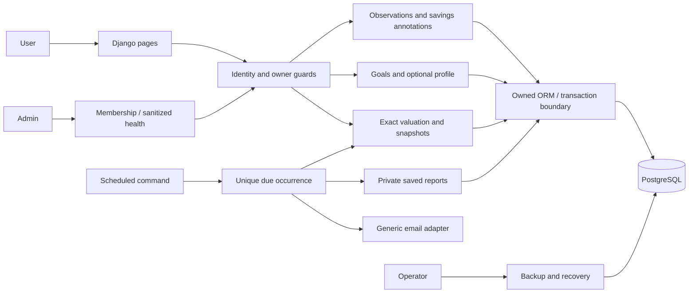
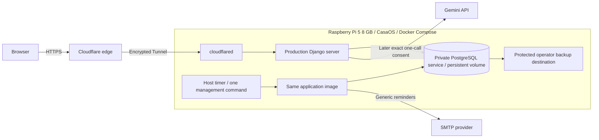

# Finance Tracker — Architecture

Status: Approved target direction (DEC-020 through DEC-026); mechanisms and compatibility retain the gates in the Decision Log. Intended release environment: Raspberry Pi 5 (8 GB), CasaOS, Docker Compose and Cloudflare Tunnel with HTTPS. Existing code remains the accepted TASK-001 Streamlit runtime shell. This revision implements no Django, database, CI or infrastructure.

## Modular monolith and prototype-first delivery

Use Django server-rendered pages and standard authentication foundations, Python application services, independently testable exact financial functions and PostgreSQL. Pandas/Plotly are optional presentation helpers, not mandatory early dependencies or authoritative arithmetic. One scheduled management command shares the same services; no queue/broker, separate frontend application, microservices or scheduler inside page requests.

M-009 uses the first 16 hours of existing packages: TASK-022A (8), TASK-025A (4), TASK-004A1 (4). Deliver Dashboard/Accounts navigation, readable name/currency/balance cards, clear empty state, intuitive validated account form and a synthetic-data banner. Standard login/logout/CSRF and initial owner relationships exist from the first slice. A locally provisioned synthetic identity and disposable SQLite database remove PostgreSQL/cloud setup from that demo. Start the intended custom Django user model and reusable Account/cash-observation model from the first migrations; extend rather than replace those foundations later. Never import real data into this database or treat it as a production migration source.

All intermediate work remains synthetic. PostgreSQL/ownership hardening, full membership, Admin MFA, privacy, recovery and final system/deployment verification are release gates before real users or sensitive data. The early slice does not require finished CI or Pi infrastructure.

## Components

| ID | Component | Boundary |
|---|---|---|
| CMP-001 | Django presentation | Server-rendered forms, navigation, readable cards, dashboard/goal/profile/report views; minimal CSS, no SPA. Prototype usability first. |
| CMP-002 | Configuration and runtime | Separate prototype/release settings, secrets, CI and intended Pi/CasaOS/Compose/Tunnel operating boundary. |
| CMP-003 | Historical ledger component | Deferred; original posting/transaction subsystem is not part of the MVP. |
| CMP-004 | Valuation, history and reports | Pure exact wealth/projection calculations, coherent immutable snapshots, completeness and honest residual attribution. |
| CMP-005 | Goals | Owned targets and account links; qualified progress, no cash reservation or spending restriction. |
| CMP-006 | Persistence | Django ORM/repository and transaction boundaries, PostgreSQL ownership constraints, version/replay guards; prototype SQLite subset only. |
| CMP-007 | Later Gemini boundary | Minimized exact one-call consent, bounded request, labeled untrusted explanation; no write tools. |
| CMP-008 | Historical Telegram component | Deferred; not reused as the email implementation. |
| CMP-009 | Scheduled command | One scheduled management-command entrypoint, unique occurrence claims, prior-month report generation and reminder scheduling. |
| CMP-010 | Portability and recovery | User-only exports, operator PostgreSQL backup/restore, validation, safety copy and rollback. |
| CMP-011 | Identity and authorization | Django user/session foundations, invitations, Admin/User policy, Admin MFA, ownership guards and sanitized health. |
| CMP-012 | Savings observations and movements | Atomic manual updates and revisions, contribution/withdrawal annotations, completeness assertions and no duplicate balance effects. |
| CMP-013 | Financial profile | Optional manually maintained monthly estimates, explicit review dates and estimate labeling. |
| CMP-014 | Email boundary | Generic reminder and membership/reset emails to intended verified addresses; no financial report delivery or report bearer token. |

## Service interfaces and data flow

These are conceptual in-process contracts, not a new public HTTP API. Every request/service receives server-authenticated owner context; a client-supplied owner ID is never authoritative.

| Boundary | Input and result |
|---|---|
| Observation update | Owned accounts, observed balances/quantities/dates, optional movement annotations, expected versions and submission identity -> atomic saved batch or structured rejection. |
| Valuation/history | Owned coherent source versions and as-of date -> exact values, currency, missing/stale flags, coverage and immutable snapshot. |
| Attribution | Comparable snapshots, dated reported flows and version-bound completeness assertion -> recorded change, reported net contribution, supported residual or unknown with reason. |
| Goal | Owned target/account-link command or dated query -> qualified progress and indicative contribution; never cash locking. |
| Profile | Optional estimates or explicit unchanged review -> saved review time; no balance/movement write. |
| Report runner | Supplied instant and owned schedules -> claimed occurrence and immutable prior-month report; independent of SMTP or profile update. |
| Email | Approved generic template, intended verified recipient and occurrence key -> acknowledgement/definite failure/uncertain metadata; no financial payload. |
| Later Gemini | Exact approved immutable minimized context/question -> untrusted explanation or bounded redacted failure; no SQL/tools/write callbacks. |
| Recovery | Separately authorized operator backup/candidate -> validated artifact or stopped-writer restore with rollback and session/job safeguards. |

Update service validates exact amounts and owned references, checks versions/replay, writes observations/movements/guard in one short transaction and invalidates only owned caches. A reported contribution describes the entered balance; it never adds to it again. PostgreSQL must serialize competing edits to affected accounts or reject stale versions; lock acquisition ordering and replay mechanism are reviewed at OQ-007. Snapshot queries use one coherent committed view, not independently refreshed cards/report sections. Never hold write locks during SMTP/Gemini requests.

Current values come from eligible latest observations and dated manual prices. Revision preserves originals; zero observations close holdings. Saved snapshots/reports are immutable; new revision is explicit. An interval-completeness assertion binds endpoints, account coverage and movement/source revision; changed inputs invalidate it. No entries does not imply zero flows. A residual is change excluding reported contributions, not investment profit or a return rate.

## Identity, Admin and operating boundaries

Application Admin and User roles are distinct. Admin has membership/health permissions, no financial queries, financial admin-model registrations, arbitrary password setting, impersonation or email/role-change takeover. Reset initiation sends to the existing verified address; any membership/email/role lifecycle must preserve this boundary and prevent removing the last recoverable Admin. Personal finance use by an operator requires a separate User identity. Application Admin is not a Django superuser. Host/database operator capability is documented separately; do not promise protection against root/database access.

Financial ownership applies to services, ORM queries, FK relationships, exports, report URLs, caches, error details and background jobs. Global caches must include owner/source version. Use non-superuser runtime database credentials and separate migration/backup privileges. Optional PostgreSQL row security may be reviewed as defense in depth, but never replaces explicit service authorization or tests. The MVP does not require a multi-tenant platform.

## Intended deployment: later implementation and verification

Compose manages a small app/database/tunnel stack; the scheduled command reuses the app image and database. CasaOS is the intended host management layer, not an application login or a user-facing dependency. Keep its management UI and Docker socket outside the public application route and out of the app container. Do not add a continuously running distributed worker or production self-hosted CI runner.

Production uses a supported server, private database/service networking and persistent volumes; never Django's development server. No public database port or direct public origin; if a host port is needed for Tunnel it stays loopback. Configure allowed hosts, forwarded HTTPS trust, secure cookies and CSRF for the actual topology, and prevent Cloudflare/browser caching of private responses. Cloudflare sees application traffic in transit; it is not end-to-end secrecy from that provider. SMTP receives recipient/subject/generic content; no finance attachments or token-based report access.

TASK-024 verifies Pi ARM64, Python/Django/driver/image, CasaOS/OS and Compose compatibility. TASK-020 performs separately authorized deployment/restart/recovery/rollback rehearsal; TASK-021 records observed instructions. No OS/image version, storage device, deployed service, certificate or working tunnel is claimed by these documents. CI has no production secrets or automatic deployment. A successful build never grants deployment authority.

## Scheduled reporting, recovery and remaining gates

Proposed operations at OQ-005: one periodic command considers latest due occurrence, uses unique keys for reminder/report independently, retries only definite bounded failures and surfaces ambiguous email sends. The report saves even if reminder failed or data is unchanged. Period-end wealth/flows use eligible dated observations; current goal/profile information is explicitly labeled as of generation unless historical versions exist. No invented historical state.

Recovery is an operator operation, not an Admin/User database download. Produce consistent PostgreSQL backups, validate restore in a separate target, stop writers, keep a safety backup and roll back on failure. Restore invalidates sessions and pauses outbound work until reviewed reconciliation; an old database can otherwise restore live tokens or resend old reminders. Define protected off-device copy, cadence/retention, RPO/RTO and storage at OQ-006/008. Source-reviewed diagrams are not a claim of renderer or deployment validation.
