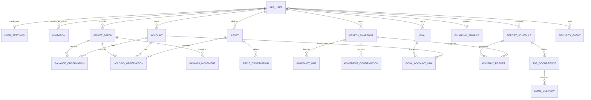

# Finance Tracker — Savings and Wealth Data Model

Status: Revised conceptual model pending human review; PostgreSQL remains unimplemented. Approved scope is observation-based (DEC-021), with no required detailed ledger, trade records or cash reservations. Exact limits, revision/replay mechanisms and deployment versions retain their gates.

## Representation and authoritative values

Use stable IDs and PostgreSQL relationships. Money uses signed-64-bit integer minor units with explicit currency/scale; cash and goal/flow amounts follow their nonnegative/positive rules. Quantities/prices use exact Decimal-compatible NUMERIC, with validation before any database scale coercion; the proposed 8-digit fractional cap and half-even/ceiling policy require OQ-002 review. Reject nonfinite and out-of-range input; never use floats for authoritative finance. Use native dates and UTC-aware recorded timestamps, interpreting effective financial dates in the User's timezone.

Initial prototype schema uses standard Django user/account/cash-observation models with disposable SQLite and synthetic fixtures. It is a reusable ORM subset, not evidence of PostgreSQL locking/precision/constraints or production suitability. TASK-003 extends the model and verifies PostgreSQL; no financial legacy data migration exists.

## Entity catalog

| Entity | Minimum conceptual attributes | Integrity / purpose |
|---|---|---|
| APP_USER | Django user identity, normalized unique email, active/role flags, password hash; standard sessions and selected MFA storage remain framework-managed. | Admin/User is application policy; do not expose superuser capability. |
| USER_SETTINGS | owner unique FK, reporting currency/scale, timezone, freshness settings, financial revision. | Currency locks after first financial record; per-user settings, not global dataset singleton. |
| INVITATION | intended email, token hash, expiry, used/revoked timestamps, issuing Admin FK. | Single-use; no plaintext token in records/logs. |
| ACCOUNT | id, owner FK, normalized name, savings/investment kind, archive time, version. | Name unique per owner; no authoritative independently editable investment-account total. |
| ASSET | id, owner FK, name/type, declared unit, optional descriptive quoted currency. | Units with observations cannot silently change; no global cross-user instrument sharing required. |
| UPDATE_BATCH | id, owner FK, submission key, immutable request fingerprint, recorded_at. | Unique owner/key; observations and movement annotations commit together. |
| BALANCE_OBSERVATION | id, owner/account/batch FKs, nonnegative cash_minor, effective_date, recorded_at, supersedes FK, reason, version. | Base-currency cash within any account; latest eligible active revision supplies cash. Zero is valid. |
| HOLDING_OBSERVATION | id, owner/account/asset/batch FKs, exact quantity, effective_date, recorded_at, supersedes FK, reason. | Non-cash quantities; zero closes a position; no trade journal is needed. |
| PRICE_OBSERVATION | id, owner/asset FKs, exact positive unit price, effective_date, recorded_at, supersedes FK, reason. | Price is in owner reporting currency; preserve revisions and do not use future prices. |
| SAVINGS_MOVEMENT | id, owner/batch FKs, effective_date, contribution/withdrawal/internal kind, positive amount_minor, optional source/destination account FKs. | External vs boundary of all tracked accounts; unknown in-kind amount prevents completeness, not an invented value. Amount is required for counted flow; an unknown flow can instead remain an unclassified update. |
| MOVEMENT_CONFIRMATION | owner FK, start/end snapshot FKs, confirmed_at, coverage and source/movement revision binding. | Explicit all-external-movements declaration for the interval; never inferred from absence. Invalidate on affected revision/scope change. |
| WEALTH_SNAPSHOT | id, owner FK, as_of_date, generated_at, currency/scale, calculation_version, revision_of FK, exact subtotal_minor, completeness flags. | Immutable snapshot header plus frozen coverage/source manifest; residual attribution stored only with valid confirmation. |
| SNAPSHOT_LINE | snapshot/account/asset optional FKs, frozen quantity/price/value_minor, source IDs, observation dates, warnings. | Frozen values/provenance survive later edits; cash line has no noncash asset requirement. |
| GOAL | id, owner FK, name, target_minor, target_date, active/closed status, timestamps. | Targets/progress do not create wealth; no reserved amount field. |
| GOAL_ACCOUNT_LINK | id, owner/goal/account FKs, created_at, released_at. | Unique active link per account, including concurrent assignments; closure releases links atomically. |
| FINANCIAL_PROFILE | owner unique FK, optional estimated monthly income_minor and expenses_minor, updated_at, reviewed_at. | No postings; explicit unchanged review refreshes reviewed_at; missing values remain missing. |
| REPORT_SCHEDULE | id, owner FK, enabled, timezone, monthly day/time, reminder lead, revision, timestamps. | Proposed schedule policy at OQ-005; no enabled schedule by default. |
| MONTHLY_REPORT | id, owner/schedule/wealth_snapshot FKs, period start/end, generated_at, revision_of FK, calculation_version, immutable exact summary/profile/goal values and warnings. | Owner-only retrieval; separate generation-time goal/profile values from period-end wealth. No public or bearer report link. |
| JOB_OCCURRENCE | id, owner/schedule FKs, kind reminder/report, due instant, schedule revision, status, claim/completion timestamps. | Unique schedule/kind/revision/due occurrence; report idempotency and schedule edits need explicit OQ-005 handling. |
| EMAIL_DELIVERY | id, occurrence FK, verified recipient reference, attempts/status, provider acknowledgement, sanitized error/times. | Generic templates only; no financial body, reset/invitation token or prompt retention. |
| SECURITY_EVENT | id, actor FK optional, event kind, timestamp, sanitized target/account-lifecycle metadata. | No financial values/payloads; necessary membership/MFA/recovery operational audit only. |

The catalog defines conceptual responsibilities, not generated migrations or final field signatures. Django/framework session/MFA tables are implementation details reviewed under OQ-010.

## Ownership, revisions and concurrency

- All private entities carry owner context directly or through a mandatory owned parent. References among accounts, assets, batches, movements, goals, snapshots and reports must have the same owner. Enforce that relationship at the database boundary as well as services; a simple independent FK alone does not prove same-owner integrity. Review concrete composite constraints/migrations in TASK-003.
- Maintain per-owner/account versions. A write checks expected version, locks relevant rows in deterministic order, validates and commits one batch plus replay key/fingerprint. Identical committed intent returns original result; key reuse with changed payload fails. Rolled-back keys do not consume the intent. Exact locking/replay policy is OQ-007.
- Preserve observations via superseding revisions and reason; only one active revision of an observation and one eligible observation per owner/account/asset/effective date. Corrections cannot change owner, currency or unit meaning. Zero quantity closes a holding without erasing history. Account archive preserves history and changes comparison coverage.
- At an as-of date, select only observations/prices effective on or before that date. Cash is counted once; investment-account total is derived from cash plus priced holdings. A reported aggregate account balance cannot be added to those holdings.
- Coherent snapshot generation freezes its account coverage, values/source versions and flags in one read transaction. Saved snapshots/reports are immutable; originals and later revisions remain distinguishable. Missing history stays missing. Goal/profile generation-time information is labeled independently when no period-end version exists.
- User movement confirmation binds the interval to immutable endpoints and applicable source/flow revisions. Missing classification, unknown valuation or changed coverage yields unknown attribution. A supported residual is never labeled investment profit or a return percentage.
- One active GOAL_ACCOUNT_LINK per account is a database uniqueness rule, independent of target status. End links atomically when closing the goal. There is no financial cash lock or duplicated goal balance.

## Editable ER diagram

Relationships shown are representative; catalog/service rules additionally constrain ownership, revision chains, source/destination movements and the two confirmation endpoints. No diagram relationship grants Admin financial access. Revisions cannot cycle.

## Historical model and recovery

The earlier DATASET_SETTINGS singleton becomes per-user settings. FINANCIAL_TRANSACTION and POSTING remain deferred ledger proposals; GOAL_ALLOCATION remains a deferred reservation proposal. TELEGRAM_SETTINGS/NOTIFICATION_RULE/NOTIFICATION_DELIVERY are deferred Telegram entities, not aliases for new report/email tables. Their original definitions are retained in Git baseline `5052b5b`; no such deployed tables or migrations need conversion.

PostgreSQL backup/restore is operator-only, consistent and candidate-validated; CSV is User-only portability with exact values/formula neutralization. A restored snapshot preserves ownership, revision/replay and report provenance. Before resumption revoke sessions/tokens as appropriate and pause jobs to reconcile invitation/reset and delivery state; secrets remain externally supplied. Location/cadence/retention/RPO/RTO and physical storage are unresolved operating gates, not implemented controls.
