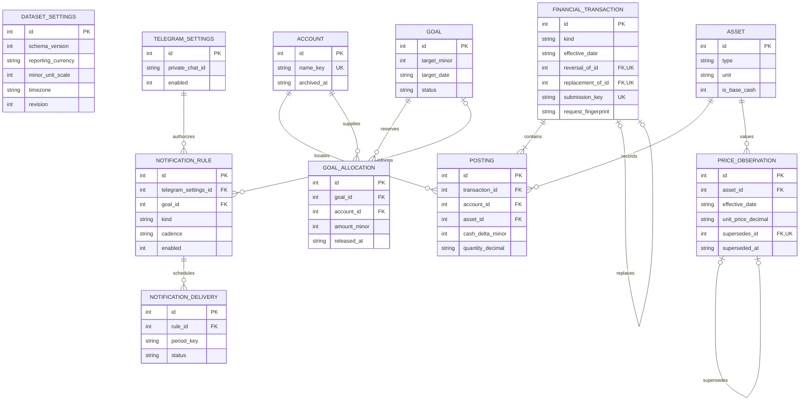

# Finance Tracker — Initial Relational Data Model

Status: **Proposed design only.** No tables, migrations, schema initialization, or database files are created by this document. DEC-018 authorizes TASK-001's runtime/configuration/startup and relevant documentation/test scope only, with execution explicitly held; it does not approve or authorize implementing this schema or other financial/integration features. Review DEC-010/011/014 and OQ-002 before implementing persistent semantics. See [SRS business rules](../requirements/SRS.md), [architecture](ARCHITECTURE.md), and [Decision Log](../DECISION_LOG.md).

## 1. Representation and entity catalog

Use SQLite INTEGER primary keys unless stated otherwise. Required attributes are non-null; optional attributes are explicitly marked nullable. IDs are dataset-local stable references, not externally meaningful identities. Store UTC creation/update instants as ISO 8601 text; financial effective dates are local `YYYY-MM-DD` text. Store one configured IANA reporting timezone for date/schedule interpretation.

Monetary amounts use signed 64-bit INTEGER **minor units** in the one dataset reporting currency. For scale 2, 12345 means 123.45. Persist the currency code and scale together at dataset creation; lock both after financial records exist. Reject excess fractional digits and overflow before SQLite writes. Production currency codes use an explicitly supported ISO 4217 set and its scale; a synthetic code used in tests is not accepted as a real currency.

Non-base-cash quantities and unit prices use canonical decimal TEXT, with a proposed maximum of 8 fractional digits and exact Python decimal parsing. Never use SQLite REAL/NUMERIC affinity or binary float for authoritative finance arithmetic. Per-holding multiplication uses exact decimals, rounds half-even once to minor units, and totals sum those rounded values. Required goal contributions round upward. Chart libraries may receive converted final values for display, never feed calculations back into persistence.

| Entity | Attributes and keys | Purpose / constraints |
|---|---|---|
| DATASET_SETTINGS | `id` PK fixed 1; `schema_version` INTEGER; `reporting_currency` TEXT; `minor_unit_scale` INTEGER; `timezone` TEXT; `stale_after_days` INTEGER; `revision` INTEGER; `created_at` TEXT | Singleton local dataset metadata, no credentials. Proposed initial stale threshold 7 days; supported minor-unit scales 0–4. Increment revision on financial/settings changes used by report caches. |
| ACCOUNT | `id` PK; `name` TEXT; `name_key` TEXT UNIQUE; `archived_at` TEXT nullable; `created_at`, `updated_at` TEXT | Logical holding location. Application-normalized case-insensitive name key avoids SQLite's ASCII-only case-fold assumptions. Archive only at zero holdings/no active allocations. |
| ASSET | `id` PK; `name` TEXT; `type` TEXT; `unit` TEXT; `quoted_currency` TEXT nullable; `is_base_cash` INTEGER; `archived_at` TEXT nullable; `created_at`, `updated_at` TEXT | Type in cash/currency/gold/stock/fund. Exactly one base-cash definition, price fixed at one and unit equal to reporting currency. Other currencies are ordinary manually priced assets; quoted currency is descriptive, not an FX instruction. |
| FINANCIAL_TRANSACTION | `id` PK; `kind` TEXT; `effective_date` TEXT; `category` TEXT nullable; `note` TEXT nullable; `reason` TEXT nullable; `reversal_of_id` FK to same table nullable UNIQUE; `replacement_of_id` FK to same table nullable UNIQUE; `submission_key` TEXT nullable UNIQUE; `request_fingerprint` TEXT nullable; `created_at` TEXT | Kind in opening/income/expense/transfer/purchase/sale/adjustment/reversal. Category required for income/expense; reason required for adjustment/reversal. Reversal and replacement links preserve audit chains; a reversal cannot itself be edited as a financial event. DEC-016 proposes paired submission-key/fingerprint metadata; opening commands require both for durable replay protection, other event kinds may leave both null pending their workflow design. |
| POSTING | `id` PK; `transaction_id` FK; `account_id` FK; `asset_id` FK; `cash_delta_minor` INTEGER nullable; `quantity_decimal` TEXT nullable | Exactly one value representation: base cash uses signed nonzero integer minor units; all other assets use signed nonzero canonical quantities. `UNIQUE(transaction_id, account_id, asset_id)`. No independently editable balance column. |
| PRICE_OBSERVATION | `id` PK; `asset_id` FK; `effective_date` TEXT; `unit_price_decimal` TEXT; `supersedes_id` FK to same table nullable UNIQUE; `superseded_at` TEXT nullable; `created_at` TEXT | Positive finite reporting-currency unit price. No base-cash price rows. One active observation per asset/date; revisions preserve the original. Corrections may restate earlier charts. |
| GOAL | `id` PK; `name` TEXT; `target_minor` INTEGER; `target_date` TEXT; `status` TEXT; `created_at`, `updated_at` TEXT | Positive target; status active/archived/deleted. No redundant stored progress percentage or contribution. A status change away from active releases allocations in the same transaction after confirmation. |
| GOAL_ALLOCATION | `id` PK; `goal_id` FK; `account_id` FK; `amount_minor` INTEGER; `created_at` TEXT; `released_at` TEXT nullable | Positive base-cash reservation. One active row per goal/account. A partial release closes the row and creates the remaining active reservation atomically, preserving allocation history without promising historical goal charts. |
| TELEGRAM_SETTINGS | `id` PK fixed 1; `private_chat_id` TEXT nullable; `validated_at` TEXT nullable; `confirmed_at` TEXT nullable; `enabled` INTEGER; `updated_at` TEXT | One private-chat allowlist. Store IDs as text to avoid cross-language precision loss. Bot token comes from environment only. Changing the destination clears confirmation and disables rules until reapproved. |
| NOTIFICATION_RULE | `id` PK; `telegram_settings_id` FK; `goal_id` FK nullable; `kind` TEXT; `cadence` TEXT; `day_value` INTEGER; `local_time` TEXT; `timezone` TEXT; `approved_fields_json` TEXT; `approved_at` TEXT nullable; `enabled` INTEGER; `created_at`, `updated_at` TEXT | Kind summary/goal_reminder/goal_update; cadence weekly/monthly; day is weekday 1–7 or month day 1–28. Goal FK required for goal kinds, forbidden for summary. JSON is a small field-name allowlist validated by Python, not a query language. No schedule enabled by default. |
| NOTIFICATION_DELIVERY | `id` PK; `rule_id` FK; `period_key` TEXT; `status` TEXT; `attempt_count` INTEGER; `claimed_at` TEXT; `next_attempt_at` TEXT nullable; `provider_message_id` TEXT nullable; `last_error_code` TEXT nullable; `completed_at` TEXT nullable | `UNIQUE(rule_id, period_key)`; status claimed/retry_pending/sent/failed/uncertain/skipped. Attempts bounded at three for automatic definite-failure retry. No message body, prompt, or token stored. |

Holdings are derived aggregates per `(account_id, asset_id)` from postings; an ACCOUNT_ASSET or BALANCE table is unnecessary initially. Cash value is `sum(cash_delta_minor)`; other holdings sum exact parsed quantities in Python. Persisting a second balance would create another reconciliation obligation without Charter benefit.

## 2. Relationships and editable ER diagram

An account and an asset each have zero or more postings. Every financial transaction has one or more postings; domain validation enforces the kind-specific number. A goal has zero or more allocations; each allocation references exactly one goal and account. A noncash asset has zero or more dated prices. Settings singletons are not user accounts.

The diagram lists representative keys and relationship fields; the catalog above defines all attributes. Self-links are optional per child record: a transaction may reverse/replace one original, and an original has at most one direct reversal and replacement. Price revisions use the same optional one-to-one chain rule.

DATASET_SETTINGS is intentionally standalone: its reporting currency applies to the whole dataset rather than through repeated currency foreign keys. Self-link acyclicity and valid reversal/revision targets require application validation in addition to FKs. Mermaid notation reference: [official ER documentation](https://mermaid.js.org/syntax/entityRelationshipDiagram.html). Source review is not renderer validation.

## 3. Constraints, atomicity, and transaction history

### Declarative constraints and indexes

- Enable `PRAGMA foreign_keys = ON` for every connection and use parameterized statements. Use NOT NULL, enum-like CHECK constraints, positive integer checks, the posting representation XOR, and FKs with RESTRICT deletion. Never cascade-delete posted financial history.
- Enforce singleton IDs and at most one base-cash asset with uniqueness constraints/partial indexes. Initialization creates the required base-cash definition; application validation prevents deleting, archiving, or changing it, maintaining exactly one. Index postings by `(account_id, asset_id, transaction_id)` and `transaction_id`; transactions by `(effective_date, id)` and `(kind, effective_date)`.
- Use an active unique price index on `(asset_id, effective_date)` where `superseded_at IS NULL`, plus a price lookup index on `(asset_id, effective_date)`. Superseding a price updates its superseded marker and inserts the new row together.
- Use an active unique allocation index on `(goal_id, account_id)` where `released_at IS NULL`; index active account allocations for reservation checks. Index goal status/date, enabled rules, and delivery status/next-attempt time. The delivery `(rule_id, period_key)` unique key is the duplicate-claim guard.
- SQLite cannot enforce aggregate cash availability or all decimal-string semantics with simple CHECK constraints. Validate these centrally in domain services and enforce the same service path for every entry point; do not imply that an FK alone prevents overspending.

### Transaction-kind rules

| Kind | Posting shape and reporting classification |
|---|---|
| Opening / adjustment | One or more explicit asset/cash deltas with provenance; adjustment reason required. Neither is income or expense. |
| Income | One positive base-cash posting; required category. Included once in income. |
| Expense | One negative base-cash posting; required category. Included once in expenses as a positive reported amount. |
| Transfer | Two opposite base-cash postings in different accounts, equal absolute amounts; excluded from cash-flow income/expense. |
| Purchase / sale | One noncash quantity posting plus one opposite base-cash settlement posting in the same account; a cross-account settlement requires a separate transfer. No implicit fee duplication or income classification. |
| Reversal | Exact negation of all original postings, same original effective date, one reversal per effective original. Reporting uses the original event kind and signed reversal amounts, so totals cancel instead of becoming new income. |

Correcting an effective event inserts its reversal and an optional replacement with a link to that original. The replacement is a new effective event that can later be corrected through its own chain. Deletion inserts a reversal only. Old postings remain immutable; reports sum originals, reversals, and replacements exactly once. A previously reversed event cannot be reversed again; linked cycles are forbidden. Correcting notes/categories uses the same mechanism so no silently mutable financial history is implied.

Validate nonnegative end-of-day holdings across all affected dates and current balances after any backdated operation. Also validate current active goal reservations against resulting base cash; past allocation balances are not used as a time-series constraint. This prevents a backdated edit from silently creating an impossible historical holding or spending today's reserved savings.

For allocation changes and cash debits, begin one short write transaction (proposed `BEGIN IMMEDIATE`), read balances/active reservations, validate, then write and commit. A competing writer must wait briefly or fail with a retryable message, never calculate availability outside the write transaction and commit blindly. Proposed lock wait: at most 5 seconds; no unbounded retry loop. Do not perform API calls while holding this lock.

### First-dashboard opening integrity and proposed replay mechanism

M-001A uses the same schema/repository boundary as the complete core. A create/list-only UI registers existing holdings, not a purchase: persist the new definition when needed, opening transaction/posting, optional initial price, and replay guard in **one** write transaction. Read quantities from postings; no separate editable balance is introduced. Base cash keeps its fixed unit/price. UI asset-unit edits are unavailable at this milestone; the policy for later referenced-unit edits remains OQ-002.

DEC-016 proposes a unique `submission_key` plus an immutable server-computed canonical-request fingerprint on FINANCIAL_TRANSACTION. Require both or neither in storage; require both for opening commands. A matching committed key/fingerprint returns the original result without a new write; a mismatched fingerprint rejects. Validate/query the key and write the opening inside the same unit of work; database uniqueness prevents racing replays. The key is stable for a retry/rerun and replaced only for an explicitly new intent, not inferred from equal amounts. A rollback removes all rows and leaves the failed command retryable. No new table or external service is needed; this is a proposal awaiting OQ-007 review, not an implemented schema.

TC-051 tests sequential/concurrent/restarted replays and conflicting payloads; TC-052 exercises the complete small dashboard. M-001A backup/restore preserves financial/history and replay metadata so restoring an accepted submission does not remove its duplicate guard. Restoring an older snapshot still returns to that snapshot's recovery point, not a promise to retain later commands. Essential restore validation, stopped writers and a pre-restore backup are required at the early gate; the procedure must not be reduced to raw live-file copying.

### Allocation example

Cash in account A is 1000. Goal G1 reserves 700 and G2 reserves 200, leaving 100 available. A 150 expense, 150 transfer, or 150 trade settlement is rejected until the user releases at least 50. Moving 100 between goals releases and reserves in one transaction, so no intermediate state can duplicate funds. Goal totals are views of the reservations and never additional holdings.

## 4. SQLite and operational considerations

Use local disk with the default rollback-journal mode initially; this workload does not justify assuming WAL. Leave durable synchronization enabled. A future measured read-contention problem can justify WAL in a separate decision, with corresponding backup/restore changes. Do not put the dataset on a network share or assume a copied live database file is a consistent backup.

Create consistent backups through the [SQLite backup mechanism](https://www.sqlite.org/backup.html), then validate the completed destination. Restore only a supported schema/version, after integrity, foreign-key, decimal, and financial-invariant checks. Stop UI/runner writers, retain a safety snapshot, replace safely, and verify reopening before resuming. Schema version checks are planned; actual migrations are not created here. Credentials must be supplied again from the environment, not recovered from a database/export.

CSV export should include headers, stable IDs, reporting currency/scale, exact values, and a small manifest describing selected record groups and date range. Include transactions/postings, accounts/assets, prices, goals, and allocations needed to interpret exported data. Neutralize text beginning with spreadsheet formula characters and document that transformation; CSV is not a lossless disaster-recovery backup or a supported import path.

Delivery rules retain local timezone and approved fields. A rule edit disables/reapproves content as needed and prevents a claimed-but-unsent stale configuration from sending without revalidation. Period keys include the rule ID and local due instant/period so repeated scheduler invocation claims only one occurrence. On restore, automatically disable notification rules and clear destination confirmation: an older backup can lack recent delivery acknowledgements, so re-enabling requires recipient/content review to avoid silent duplicate reports.

## 5. Decision status and remaining confirmations

- Runtime selection is approved by DEC-017: current Linux environment, Python 3.14.x with locally installed 3.14.8 as the initial target, venv, pip, and pytest. OQ-004's selection is resolved; dependency compatibility and exact compatible dependency versions remain unverified TASK-001 work. Report incompatibilities rather than silently changing Python or architecture. DEC-018's limited authorization leaves OQ-001 open for the remaining baseline; TASK-001 remains Not Started.
- Exact precision cap, rounding policy, same-account trade settlement, correction/reversal rules, restated history and referenced-unit edit restrictions: DEC-010/011, OQ-002.
- Persistent opening-submission replay fields/guard: proposed DEC-016, OQ-007, before TASK-003/005A; duplicate prevention itself is approved under DEC-015.
- Stale threshold: DEC-012, OQ-003.
- Notification recurrence, missed/uncertain delivery policy, and restore-time disablement: DEC-013, OQ-005.
- Backup location/cadence/retention and recovery targets: DEC-014, OQ-006.

The confirmed product choices remain one reporting currency, assets only, base-cash goal reservations, per-request AI approval, network-controlled access, and notifications-only Telegram. Technical proposals must not be mistaken for additional approved scope.
