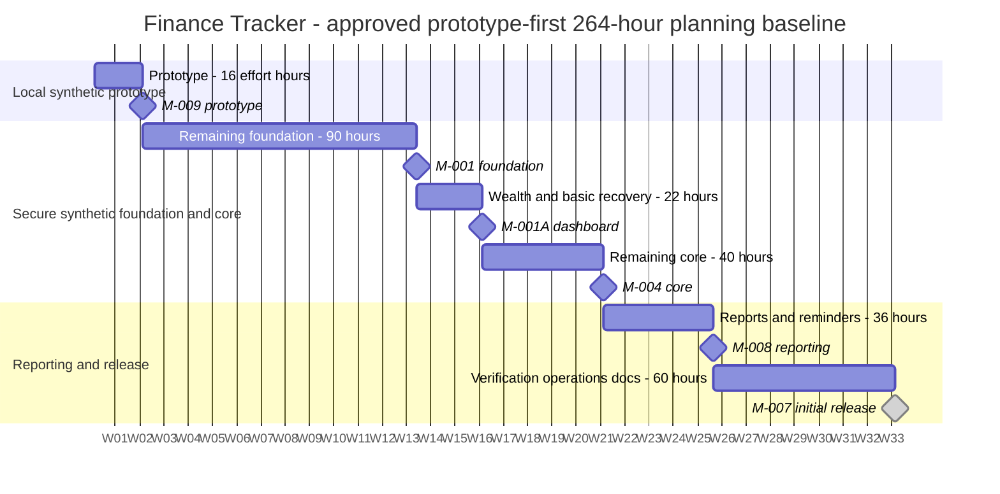

# Finance Tracker — Project Schedule

Status: **Owner-approved planning baseline DEC-025**, documented 2026-11-05: **264 remaining development hours / 33 weeks at 8 hours/week**, including a **16-hour Early Working Prototype**. No calendar start/deadline is approved. Revised document acceptance remains pending human review; no future task/milestone is completed. Existing TASK-001 acceptance is historical and excluded from remaining effort.

Intended later deployment: Raspberry Pi 5 (8 GB), CasaOS, Docker Compose and Cloudflare Tunnel with HTTPS. Compatibility assessment and authorized infrastructure/recovery rehearsal remain TASK-024/020 work, after the early local prototype.

## Capacity, budgets and relative milestones

| Package | Hours |
|---|---|
| Django foundation, CI and Pi compatibility | 28 |
| Authentication, invitations, roles and Admin MFA | 48 |
| PostgreSQL observations and ownership | 20 |
| Rules, account updates, movements, valuation and history | 36 |
| Goals | 12 |
| Optional profile | 8 |
| Reports, scheduling and generic reminder email | 36 |
| Recovery and exports | 16 |
| System verification | 24 |
| Deployment rehearsal and release documentation | 36 |

Prototype allocation: TASK-022A 8 h + TASK-025A 4 h + TASK-004A1 4 h =16 h, already in the packages above. Prototype 16 + subsequent work 248 =264 h. No parent/rollup, deferred task or later Gemini task is added. Uncertainty range **224–336 h / 28–42 weeks**; dependency/provider/hardware waits can increase elapsed time. Re-estimate after prototype and compatibility evidence; keep safeguards and seek approval for a changed baseline.

| Milestone | Outcome | Remaining cumulative hours | Elapsed weeks at 8 h/week |
|---|---|---|---|
| M-009 | Early Working Prototype | 16 | 2 |
| M-001 | Full secure foundation | 106 | 13.25 |
| M-001A | Wealth dashboard and basic recovery | 128 | 16 |
| M-002 | Savings updates and classification | 134 | 16.75 |
| M-003 | Historical wealth snapshots | 142 | 17.75 |
| M-004 | Functional core | 168 | 21 |
| M-008 | Monthly reporting and reminders | 204 | 25.5 |
| M-007 | Initial release | 264 | 33 |

M-009 is the new early prototype; M-008 is the new report milestone. M-005 remains the later Gemini milestone, 24 further hours after M-007 if separately selected/authorized (288 remaining hours total including that later package). M-006's Telegram commitment is withdrawn; its ID is not reused.

## Executable serial baseline

One developer, eight hours/week; logical independence does not create extra capacity. All leaf estimates include focused checks and notes. Dependencies on rollups are explicit only; no full-parent completion is inherited by the prototype children.

| Leaf | WBS | Hours | Depends on | Cumulative hours |
|---|---|---|---|---|
| TASK-022A | 1.4.1 | 8 | TASK-001 | 8 |
| TASK-025A | 1.7.1 | 4 | TASK-022A | 12 |
| TASK-004A1 | 2.1.1.1 | 4 | TASK-025A | 16 |
| TASK-022B | 1.4.2 | 8 | TASK-004A1 | 24 |
| TASK-023 | 1.5 | 6 | TASK-022B | 30 |
| TASK-024 | 1.6 | 6 | TASK-022B | 36 |
| TASK-025B | 1.7.2 | 16 | TASK-025A, TASK-022B | 52 |
| TASK-026 | 1.8 | 16 | TASK-025B | 68 |
| TASK-027 | 1.9 | 12 | TASK-026 | 80 |
| TASK-002 | 1.2 | 6 | TASK-001 | 86 |
| TASK-003 | 1.3 | 20 | TASK-002, TASK-022B, TASK-026 | 106 |
| TASK-004A2 | 2.1.1.2 | 2 | TASK-004A1, TASK-003 | 108 |
| TASK-004B | 2.1.2 | 4 | TASK-004A2 | 112 |
| TASK-008A | 3.1.1 | 6 | TASK-004B, TASK-002 | 118 |
| TASK-007A | 2.4.1 | 10 | TASK-003, TASK-008A | 128 |
| TASK-028 | 2.5 | 6 | TASK-004A2, TASK-002 | 134 |
| TASK-008B | 3.1.2 | 2 | TASK-008A, TASK-028 | 136 |
| TASK-010 | 3.3 | 6 | TASK-008B, TASK-028 | 142 |
| TASK-011 | 4.1 | 4 | TASK-008A | 146 |
| TASK-029 | 4.4 | 4 | TASK-011, TASK-003 | 150 |
| TASK-013 | 4.3 | 4 | TASK-029, TASK-002 | 154 |
| TASK-030 | 4.5 | 8 | TASK-025B, TASK-003 | 162 |
| TASK-007B | 2.4.2 | 6 | TASK-007A, TASK-010, TASK-029, TASK-030 | 168 |
| TASK-031 | 6.4 | 14 | TASK-010, TASK-013, TASK-030, TASK-007B | 182 |
| TASK-032 | 6.5 | 12 | TASK-031 | 194 |
| TASK-033 | 6.6 | 10 | TASK-032, TASK-025B | 204 |
| TASK-019 | 7.1 | 24 | TASK-007B, TASK-013, TASK-030, TASK-033, TASK-023, TASK-027 | 228 |
| TASK-020 | 7.2 | 24 | TASK-019, TASK-024 | 252 |
| TASK-021 | 7.3 | 12 | TASK-020 | 264 |

## Milestone acceptance and admission gates

- **M-009:** P1-01–P1-06 in SRS; clean usable Django Dashboard/Accounts navigation, readable account cards and intuitive form, standard development login, synthetic loopback persistence and owner demonstration. SQLite via ORM is development-only; no CI/Pi/PostgreSQL/invitations/MFA completion prerequisite.
- **M-001:** Finish remaining foundation, identity, MFA, financial rules and PostgreSQL ownership foundation. Includes the four account hours already shown, so target is 106 h rather than the previous proposal's 102 h. No recovery or real-data admission is inferred.
- **M-001A:** W1-01–W1-04 at 128 h: synthetic wealth dashboard, exact dated values/warnings, atomic owned updates and basic validated PostgreSQL recovery.
- **M-002/M-003:** Savings classification/unknown attribution, then immutable comparable wealth history. Detailed expense/trade ledgers are not prerequisites.
- **M-004:** Linked goals, indicative projections, optional profile, owned CSV and expanded recovery at 168 h.
- **M-008:** Immutable prior-month reports, configurable scheduling and generic reminder email at 204 h; no fresh-user-input or successful-email prerequisite to generation.
- **M-007:** All mandatory MVP requirements and real-data admission gates have evidence, deployment/recovery rehearsal and owner acceptance at 264 h. Real users/sensitive data and deployment each still require applicable separate authorization. All earlier work remains synthetic.

## Editable relative-week Gantt

Synthetic anchor `2001-01-01` is rendering data only. Bars represent elapsed spacing at 8 effort hours/week: 14d=16 effort hours, 1890h=90 effort hours, 462h=22 effort hours, 35d=40 effort hours, 756h=36 effort hours and 1260h=60 effort hours. Total spacing is 231 days /33 weeks; these durations are not developer-hour estimates. Tables above control interpretation.

## Historical impact and approval boundaries

DEC-015 originally approved 152 total hours, M-001A=32 h and M-004=92 h for a different single-user SQLite/Streamlit scope. That baseline is superseded for future work by DEC-025, not retroactively completed. The earlier 336-hour comprehensive-ledger proposal and pre-prototype 264-hour sequence were proposals, not additional budgets. Revised MVP removes the detailed ledger/reservations and reorders a reusable 16-hour demo without increasing 264 h.

TASK-001 stays accepted with recorded evidence at 5052b5b; no actual elapsed effort is inferred from its old 4-hour estimate. TASK-002 changes from original 4 h to 6 h for wealth/date rules; TASK-003 changes from original 8 h SQLite to 20 h PostgreSQL observations/ownership. Original A/B task identities and new splits remain traceable in the backlog. No infrastructure, commits, pushes, merges or deployment are performed by this schedule revision.
