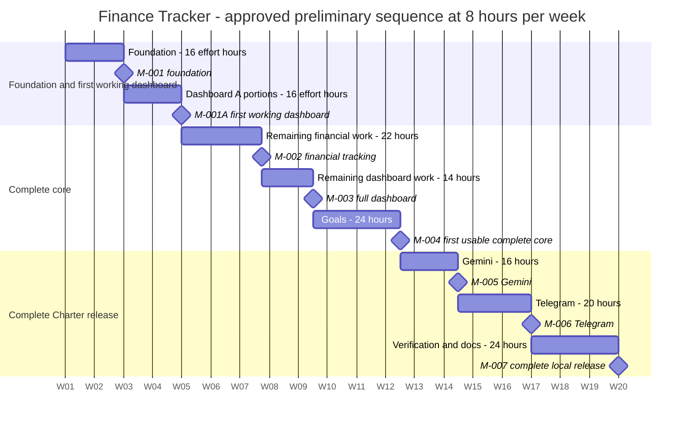

# Finance Tracker — Preliminary Project Schedule

Status: **Owner-approved preliminary baseline and M-001A reallocation** (DEC-015). No implementation is started. Capacity remains **8 hours/week** (DEC-007); the baseline remains **152 hours / 19 development weeks**. Approval establishes planning targets, not completed work or a guaranteed deadline. This documentation update consumes none of the future development-task estimates.

## 1. Deliverable budgets and relative milestones

Week 1 begins when development actually starts; no calendar start date is approved. Elapsed week 0 starts Week 1; elapsed week 11.5 is mid-Week 12. WBS phases retain their original budgets even where portions execute earlier.

| Charter phase / WBS | Budget | Reallocation |
|---|---:|---|
| 1 / 1.0 Foundation | 16 h | TASK-001–003 precede M-001A unchanged. |
| 2 / 2.0 Financial tracking | 32 h | 10 h of A portions before M-001A; remaining 22 h afterward. |
| 3 / 3.0 Dashboard | 20 h | TASK-008A's 6 h before M-001A; remaining 14 h after M-002. |
| 4 / 4.0 Goals | 24 h | Unchanged, after M-003. |
| 5 / 5.0 AI | 16 h | Unchanged, after M-004. |
| 6 / 6.0 Telegram | 20 h | Unchanged. |
| 7 / 7.0 Verification and documentation | 24 h | Unchanged; focused verification remains inside earlier packages too. |
| **Total** | **152 h** | **25 executable leaves; four parent rollups are not additional effort.** |

| Milestone | Cumulative hours | Elapsed weeks at 8 h/week | Target / acceptance |
|---|---:|---:|---|
| M-001 | 16 | 2 | End of Week 2: reviewed financial foundation, configuration, schema/repositories. |
| M-001A | 32 | 4 | End of Week 4: First Working Dashboard; M1A-01 through M1A-08 and the Definition of Done below. |
| M-002 | 54 | 6.75 | During Week 7: complete financial tracking, corrections/transfers, backup/restore/export. Previously 48 h; six hours of valuation now precede it. |
| M-003 | 68 | 8.5 | Mid-Week 9: complete valuation, monthly reporting, distribution and history. Unchanged. |
| M-004 | 92 | 11.5 | Mid-Week 12: first usable complete core with goals and original security/recovery exit criteria. Unchanged. |
| M-005 | 108 | 13.5 | Mid-Week 14: Gemini workflows verified. Unchanged. |
| M-006 | 128 | 16 | End of Week 16: authorized notifications verified. Unchanged. |
| M-007 | 152 | 19 | End of Week 19: complete Charter release reviewed, documented and accepted. Unchanged. |

### M-001A — First Working Dashboard: Definition of Done

All eight milestone acceptance checks in [SRS](../requirements/SRS.md) must be evidenced, using the [test plan](../testing/TEST_PLAN.md) milestone profile. The user can start Streamlit locally without APIs; choose the reporting currency/basic account; register and list manually entered existing holdings; see dated unit prices, exact holding values, asset totals and incomplete/stale-price warnings; and restart without losing committed records.

Definition, opening posting and optional initial price commit atomically. Exact monetary arithmetic, foreign keys, validated quantities/prices/dates/limits, rollback and persistent duplicate prevention are mandatory. A local consistent backup and candidate-validated, confirmed, stopped-writer restore with a safety copy must work before personal data is used. Required calculation, persistence, rejection, rollback, replay, missing-price and recovery checks have recorded results; owner acceptance is recorded; no unresolved integrity, data-loss or disclosure defect remains. Applicable procedures/limitations are documented. No tests have run yet.

M-001A does not include purchases/sales, income/expenses, corrections/transfers, full reports, goals or API integrations. It does not complete the broader FRs merely because opening-only scenarios pass. This milestone uses the final intended ledger/persistence boundaries, not a throwaway model.

## 2. Executable sequence and dependencies

The table is the capacity-limited serial baseline. Parent task IDs remain completion rollups in the backlog; any dependency on a parent requires **both** of its children. Child dependencies below allow safe early slices without weakening the full parent's completion gate.

| Task | Deliverable | WBS leaf | Effort | Depends on | Cumulative hours |
|---|---|---|---:|---|---:|
| TASK-001 | Runtime skeleton and local configuration | 1.1 | 4 h | None | 4 |
| TASK-002 | Exact monetary and date rules | 1.2 | 4 h | TASK-001 | 8 |
| TASK-003 | SQLite schema and repositories | 1.3 | 8 h | TASK-001, TASK-002 | 16 |
| TASK-004A | Basic account, asset registration, and listing | 2.1.1 | 4 h | TASK-003 | 20 |
| TASK-005A | Atomic opening transactions and replay protection | 2.2.1 | 4 h | TASK-004A | 24 |
| TASK-008A | Initial manual prices and first dashboard valuation | 3.1.1 | 6 h | TASK-003, TASK-004A, TASK-005A | 30 |
| TASK-007A | Essential first-dashboard backup and restore | 2.4.1 | 2 h | TASK-003, TASK-005A | 32 |
| TASK-004B | Remaining account and asset management | 2.1.2 | 4 h | TASK-004A | 36 |
| TASK-005B | Remaining income, expense, and trading ledger | 2.2.2 | 8 h | TASK-005A, TASK-004 | 44 |
| TASK-006 | Corrections and transfers | 2.3 | 8 h | TASK-005 | 52 |
| TASK-007B | CSV export and remaining recovery verification | 2.4.2 | 2 h | TASK-007A, TASK-006 | 54 |
| TASK-008B | Price corrections and valuation completion | 3.1.2 | 2 h | TASK-008A, TASK-006 | 56 |
| TASK-009 | Monthly dashboard and distribution | 3.2 | 8 h | TASK-008 | 64 |
| TASK-010 | Historical reporting | 3.3 | 4 h | TASK-009 | 68 |
| TASK-011 | Savings goal workflows | 4.1 | 4 h | TASK-009 | 72 |
| TASK-012 | Atomic cash reservations | 4.2 | 12 h | TASK-011, TASK-006 | 84 |
| TASK-013 | Contribution projections and goal views | 4.3 | 8 h | TASK-012 | 92 |
| TASK-014 | Gemini boundary and consent | 5.1 | 8 h | TASK-009 | 100 |
| TASK-015 | AI explanation workflows | 5.2 | 8 h | TASK-014, TASK-013 | 108 |
| TASK-016 | Telegram recipient and preferences | 6.1 | 6 h | TASK-001 | 114 |
| TASK-017 | Scheduled summary runner | 6.2 | 10 h | TASK-016, TASK-009, TASK-007 | 124 |
| TASK-018 | Goal notifications | 6.3 | 4 h | TASK-017, TASK-013 | 128 |
| TASK-019 | System and acceptance verification | 7.1 | 10 h | TASK-007, TASK-010, TASK-013, TASK-015, TASK-018 | 138 |
| TASK-020 | Deployment and recovery rehearsal | 7.2 | 6 h | TASK-019 | 144 |
| TASK-021 | Usage documentation and local release | 7.3 | 8 h | TASK-020 | 152 |

TASK-004A → TASK-005A → TASK-008A supplies the narrow dashboard workflow. TASK-007A then supplies tested recovery before the gate. Early backup only needs the reviewed schema/openings; it can be developed independently of advanced ledger behavior. TASK-008B still waits for TASK-006. TASK-007B still waits for TASK-006. Their rollups TASK-008 and TASK-007 are incomplete until both portions finish.

Resolve the supported runtime before TASK-001 and relevant financial/history/unit-edit and replay-guard decisions before TASK-002/003/005A. Select the actual reporting currency on dataset creation; review the proposed stale-price default before TASK-008A. No unresolved policy is approved merely by assigning its implementation hours.

## 3. Editable relative-week Gantt

Mermaid requires an internal date anchor: **2001-01-01 is synthetic rendering data only**, not an approved project start. The displayed W01, W02, … are project weeks. A milestone at the next tick is the end of the preceding elapsed week; the table above controls interpretation. No weekends are excluded and no bar is marked done/active.

Rendering durations represent calendar spacing at eight effort hours per week: 14d = 16 effort hours; 462h = 22 effort hours; 294h = 14 effort hours. They are not developer-hour estimates. The serial bars span exactly 19 weeks; milestones add zero effort.

Reference: [Mermaid Gantt syntax](https://mermaid.js.org/syntax/gantt.html). The source receives static consistency checks; local Mermaid/PlantUML rendering remains unavailable. No renderer is installed by this task.

## 4. Scheduling tradeoffs and conflicts resolved

- No new effort: 16 h foundation + 16 h early portions + 60 h remaining core + 60 h later release = 152 h. The four split budgets remain 8, 12, 4 and 8 h respectively; count leaves, never parents plus children.
- M-002 shifts from 48 h / elapsed week 6 to 54 h / elapsed week 6.75. M-003 catches up at 68 h because six valuation hours were already done. M-004 remains 92 h and M-005–007 remain 108/128/152 h.
- The former monolithic TASK-008 → TASK-006 and TASK-007 → TASK-006 dependencies would block the early milestone. They now apply to B portions/full-parent completion, while A portions depend on the schema and atomic openings. No correction/transfer prerequisite is bypassed for full valuation/recovery acceptance.
- Account/asset editing and advanced ledger operations move behind the early gate; opening-only errors must not be patched by direct balance edits. The milestone demonstrates bounded functionality rather than a full financial-management release.
- Safe backup/restore in TASK-007A has a tight two-hour allocation. Focused tests/notes stay inside that allocation; CSV and expanded regression remain in TASK-007B. Failure to meet safeguards blocks the milestone rather than waiving safety. The estimate remains preliminary.
- Logical independent work can be interleaved, but one developer is still limited to eight hours/week. No extra capacity, infrastructure, parallel agent work or future enhancement is assumed.

## 5. Uncertainty and review

Keep the existing uncertainty range **128–192 hours / 16–24 weeks**; the approved planning baseline remains 152 h / 19 weeks. The range is not added contingency or an approved deadline. Re-estimate using evidence at M-001, M-001A and M-004; an actual overrun needs an explicit schedule review, not silent task completion or weakened financial rules. Owner decision/provider waits can increase elapsed time without changing estimated developer effort.

Before implementation, the documentation review must verify leaf-only totals, parent sums, DAG/order, milestone cumulative positions, opening/recovery acceptance, test links and proposed-vs-approved status. Review results and remaining decisions are recorded in [docs README](../README.md) and [DECISION_LOG](../DECISION_LOG.md). No milestone or application test is currently complete.
