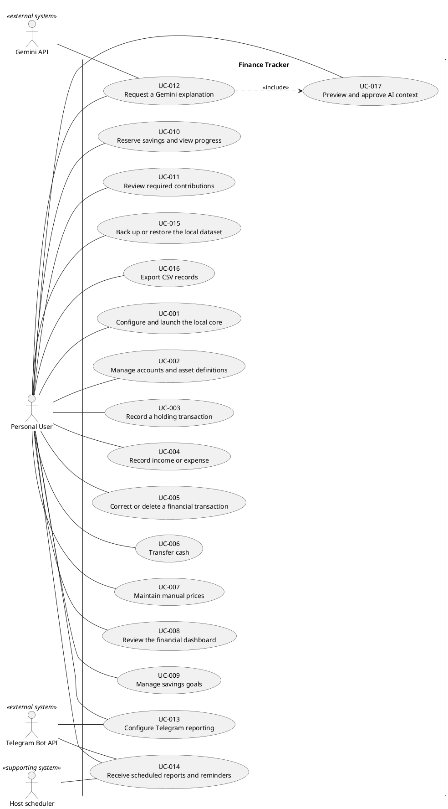

# Finance Tracker — Use Cases

Status: Proposed interactions, not implemented workflows.

## Actors and boundary

The **Personal User** is the primary actor and beneficiary. Gemini and Telegram Bot API are external supporting systems, not human users. A host scheduler is a supporting technical actor outside the application boundary: it starts the optional local runner. SQLite and internal services are components inside the boundary, not actors. UC-014 is time-triggered on behalf of the Personal User; the user does not manually initiate each delivery.

## Milestone applicability

M-001A exercises UC-001, create/list portions of UC-002, opening-only UC-003, initial-price UC-007, basic-total UC-008, and essential backup/restore UC-015. The initial asset/opening/optional-price inputs can share one form, but services commit them in one unit of work; following several use cases never permits separate partial commits. Replay protection and rollback are required (TC-051/052). Other alternatives, full reports, corrections/transfers, goals and external interactions retain later gates. M-001A does not mean these broader use cases are fully accepted; M-004 remains the 92-hour complete core.

## Specifications

### UC-001 — Configure and launch the local core

- **Primary actor:** Personal User
- **Trigger:** The user starts a fresh local installation.
- **Preconditions:** The supported local runtime is available; the user controls the host.
- **Related functional requirements:** FR-001, FR-002, FR-032

**Main success scenario**

1. Read environment configuration and validate paths.
2. Require a reporting currency/scale on a fresh dataset.
3. Open the local dataset and show the dashboard with integrations disabled.

- **Alternative flows:** An existing dataset reuses its persisted currency; absent API keys leave adapters off.
- **Exception flows:** An invalid path or incompatible dataset displays a redacted error without changing data.
- **Postconditions:** A valid local dataset is available; committed records survive restart.

### UC-002 — Manage accounts and asset definitions

- **Primary actor:** Personal User
- **Trigger:** The user opens account/asset management.
- **Preconditions:** UC-001 is complete.
- **Related functional requirements:** FR-003, FR-004

**Main success scenario**

1. Create or select an account.
2. Enter or update an asset name, type, unit, and optional quoted currency.
3. Validate and save; show the resulting account/asset list.

- **Alternative flows:** Delete unused definitions; archive zero-balance definitions whose history must remain.
- **Exception flows:** Referenced physical deletion, duplicate names, or archiving nonzero holdings is rejected.
- **Postconditions:** Definitions are persisted or no data changes on failure.

### UC-003 — Record a holding transaction

- **Primary actor:** Personal User
- **Trigger:** The user records an opening, purchase, sale, or quantity adjustment.
- **Preconditions:** Account and asset definitions exist; base cash is available for purchases.
- **Related functional requirements:** FR-006

**Main success scenario**

1. Select the transaction type and effective date.
2. Enter quantities and, for purchases/sales, base-currency settlement.
3. Validate holdings and unreserved cash; commit all postings atomically.

- **Alternative flows:** Opening holdings and explained adjustments have no income/expense classification.
- **Exception flows:** An insufficient holding/cash balance, future date, or invalid quantity rejects all postings.
- **Postconditions:** Quantities and settlement cash agree; history records the manual event.

### UC-004 — Record income or expense

- **Primary actor:** Personal User
- **Trigger:** The user opens an income or expense form.
- **Preconditions:** An active account with base cash support exists.
- **Related functional requirements:** FR-007, FR-008

**Main success scenario**

1. Enter date, category, positive amount, and optional note.
2. Validate precision, required fields, and available unreserved cash.
3. Commit the header and posting; refresh the monthly summary.

- **Alternative flows:** An empty category uses an explicit user-selected general category rather than silently guessing.
- **Exception flows:** Invalid amount or expense breaching reservations leaves the dataset unchanged.
- **Postconditions:** Cash and the selected month reflect one committed event.

### UC-005 — Correct or delete a financial transaction

- **Primary actor:** Personal User
- **Trigger:** The user selects an existing transaction for correction/deletion.
- **Preconditions:** The effective transaction exists and is not already superseded.
- **Related functional requirements:** FR-009

**Main success scenario**

1. Show the original event and proposed replacement or deletion effect.
2. Validate the resulting dated balances and current reservations.
3. After confirmation, commit the reversal and optional replacement together.

- **Alternative flows:** Cancel leaves the original event effective; descriptions may be corrected through the same history mechanism.
- **Exception flows:** A repeat deletion, negative historical holding, or reservation breach rejects the operation.
- **Postconditions:** The effective record changes once; audit history remains available.

### UC-006 — Transfer cash

- **Primary actor:** Personal User
- **Trigger:** The user chooses a transfer between accounts.
- **Preconditions:** Two distinct active accounts exist; the source has enough unreserved base cash.
- **Related functional requirements:** FR-010

**Main success scenario**

1. Select source, destination, date, and positive amount.
2. Validate both account references and source availability.
3. Commit equal opposite cash postings and refresh balances.

- **Alternative flows:** Cancel produces no posting.
- **Exception flows:** Self-transfer, insufficient funds, or a failed second posting rolls back the whole transfer.
- **Postconditions:** Total cash is unchanged and no income/expense is created.

### UC-007 — Maintain manual prices

- **Primary actor:** Personal User
- **Trigger:** The user enters or corrects a price observation.
- **Preconditions:** The non-base-cash asset exists.
- **Related functional requirements:** FR-005

**Main success scenario**

1. Select the asset and effective date.
2. Enter a finite positive reporting-currency price per declared unit.
3. Save the observation and refresh dependent valuations.

- **Alternative flows:** Correct an existing observation through an auditable superseding revision.
- **Exception flows:** A future date, zero/negative/nonfinite price, or invalid unit input is rejected.
- **Postconditions:** Dated price history is available without an external price service.

### UC-008 — Review the financial dashboard

- **Primary actor:** Personal User
- **Trigger:** The user opens or changes the dashboard period.
- **Preconditions:** A local dataset exists; it may be empty or partially priced.
- **Related functional requirements:** FR-011, FR-012, FR-013, FR-014, FR-015

**Main success scenario**

1. Read effective holdings and the appropriate dated manual prices.
2. Calculate totals, completeness, distributions, and monthly savings.
3. Display charts, historical trends, units, and warnings.

- **Alternative flows:** An empty dataset shows guidance; unpriced holdings show separately from the priced subtotal.
- **Exception flows:** A persistence error displays a recoverable message without presenting fabricated totals.
- **Postconditions:** The user sees deterministic figures; no financial records change.

### UC-009 — Manage savings goals

- **Primary actor:** Personal User
- **Trigger:** The user creates or edits a savings goal.
- **Preconditions:** The reporting currency is fixed.
- **Related functional requirements:** FR-016

**Main success scenario**

1. Enter a name, positive target amount, and target date.
2. Validate and save the goal.
3. Show the goal alongside other active goals.

- **Alternative flows:** Archive/delete with an explicit release confirmation when reservations exist.
- **Exception flows:** Invalid targets fail unchanged; past dates remain allowed with an overdue status.
- **Postconditions:** The goal is persisted; confirmed closure releases its reservations atomically.

### UC-010 — Reserve savings and view progress

- **Primary actor:** Personal User
- **Trigger:** The user allocates or releases cash for a goal.
- **Preconditions:** An active goal and a base-currency cash account exist.
- **Related functional requirements:** FR-017, FR-018

**Main success scenario**

1. Show source balance, existing reservations, and available cash.
2. Enter the reservation/release amount and validate inside a write transaction.
3. Commit and show updated remaining target and progress.

- **Alternative flows:** A fully funded goal may receive an explicit excess reservation, displayed separately.
- **Exception flows:** Over-allocation, concurrent balance changes, or invalid releases roll back the operation.
- **Postconditions:** Cash does not move; aggregate reservations remain within account cash.

### UC-011 — Review required contributions

- **Primary actor:** Personal User
- **Trigger:** The user opens a goal projection.
- **Preconditions:** A saved goal exists.
- **Related functional requirements:** FR-019

**Main success scenario**

1. Determine the unfunded target and owner-local current date.
2. Count monthly opportunities through the deadline month.
3. Display the upward-rounded contribution or overdue/funded state.

- **Alternative flows:** A deadline today has one opportunity; a funded goal needs zero.
- **Exception flows:** An invalid stored target/date is reported as a data-integrity error rather than used in division.
- **Postconditions:** The projection is shown without financial writes or Gemini calls.

### UC-012 — Request a Gemini explanation

- **Primary actor:** Personal User
- **Trigger:** The user selects spending, summary, goal feasibility, or a financial question.
- **Preconditions:** Gemini is explicitly enabled and configured; relevant deterministic summaries are available.
- **Related functional requirements:** FR-020, FR-021, FR-022, FR-023, FR-024

**Main success scenario**

1. Select the question/explanation type and reporting period.
2. Build a minimized deterministic context.
3. Perform UC-017 to preview and approve the exact payload.
4. Send once through the adapter and display an AI-generated explanatory response.

- **Alternative flows:** Canceling UC-017 ends the workflow without a request; sparse data remains labeled.
- **Exception flows:** Timeout, quota, invalid credentials, or malformed output produces a redacted error; no financial operation is executed.
- **Postconditions:** Only approved data may leave the device; financial records are unchanged.

### UC-013 — Configure Telegram reporting

- **Primary actor:** Personal User
- **Trigger:** The user enables or edits Telegram settings in the dashboard.
- **Preconditions:** The bot token is supplied by environment configuration.
- **Related functional requirements:** FR-025, FR-028

**Main success scenario**

1. Enter one private-chat recipient and validate its type/identity through Telegram.
2. Send a deliberate non-financial connection test and ask the user to confirm the destination.
3. Preview/approve report fields, timezone, and chosen schedules; explicitly enable selected rules.

- **Alternative flows:** Leave all rules disabled or disable an existing rule; changing the recipient requires revalidation and fresh content approval.
- **Exception flows:** Missing identity, group chat, mismatch, or API error prevents financial-message enablement.
- **Postconditions:** The one authorized destination and explicit preferences are persisted; no incoming command handler is enabled.

### UC-014 — Receive scheduled reports and reminders

- **Primary actor:** Personal User (beneficiary; host scheduler initiates execution)
- **Trigger:** The host scheduler invokes the local notification runner and an enabled rule is due.
- **Preconditions:** UC-013 is complete; relevant financial records exist; the host and network are available.
- **Related functional requirements:** FR-026, FR-027

**Main success scenario**

1. Claim the latest due occurrence under a unique delivery key.
2. Recheck enablement and the authorized destination; build the approved deterministic report.
3. Send through Telegram and persist acknowledgement or a bounded failure state.

- **Alternative flows:** No due work exits without a message; after downtime consider only the latest due occurrence for each rule.
- **Exception flows:** Definite transient failure may retry within the limit; timeout after send becomes uncertain and requires user resolution rather than blind resend.
- **Postconditions:** Acknowledged occurrences are not resent; financial records remain unchanged.

### UC-015 — Back up or restore the local dataset

- **Primary actor:** Personal User
- **Trigger:** The user requests a backup or a recovery operation.
- **Preconditions:** A writable owner-controlled backup path exists; restore can stop the UI and notification writers.
- **Related functional requirements:** FR-029, FR-030

**Main success scenario**

1. For backup, produce a consistent snapshot and validate it before reporting success.
2. For restore, validate a candidate separately for schema, integrity, and business invariants.
3. Show replacement impact and require explicit confirmation.
4. Stop writers, create a pre-restore backup, replace the dataset safely, then verify before resuming.

- **Alternative flows:** Cancel restore preserves live data; backup alone never replaces the current dataset.
- **Exception flows:** Corrupt/incompatible input or failure to make the safety backup aborts restore; failed replacement uses the documented rollback procedure.
- **Postconditions:** A validated backup exists, or the selected valid dataset is restored with a recovery path.

### UC-016 — Export CSV records

- **Primary actor:** Personal User
- **Trigger:** The user requests a local CSV export.
- **Preconditions:** The local dataset can be read; an owner-controlled export path is available.
- **Related functional requirements:** FR-031

**Main success scenario**

1. Choose the record groups and date range.
2. Read a consistent dataset and serialize IDs, exact amounts, units, currency/scale, and dates.
3. Neutralize spreadsheet-formula text and write a documented export set.

- **Alternative flows:** Exporting an empty selection produces headers and an explicit empty result.
- **Exception flows:** Read/write failure gives no success claim; secrets and API configuration are never exported.
- **Postconditions:** Portable CSV files exist; the database is unchanged and CSV is not represented as a backup.

### UC-017 — Preview and approve AI context

- **Primary actor:** Personal User
- **Trigger:** UC-012 prepares a Gemini request.
- **Preconditions:** A current question and minimized summary are available.
- **Related functional requirements:** FR-024

**Main success scenario**

1. Display the exact outbound financial summary and question.
2. Explain external transmission and allow cancel or edit.
3. Bind explicit send approval to this payload for this request only.

- **Alternative flows:** An edit rebuilds the preview and requires new approval.
- **Exception flows:** A changed underlying summary invalidates the pending approval and requires review again.
- **Postconditions:** A single approved payload is returned to UC-012, or no request is authorized.

## Editable UML use-case diagram

PlantUML is used for UML actor associations and an actual include relationship. UC-012 includes UC-017 because every attempted send requires preview/approval; cancellation exits before transmission. No extend relationship is needed. All actor associations describe participation, not data-flow direction. This source is authoritative and can be extracted into a `.puml` file later; no renderer or generated screenshot is required for editing.

Syntax reference: [PlantUML use-case documentation](https://plantuml.com/use-case-diagram). The diagram is source-reviewed only; local rendering was unavailable. The user association with UC-014 represents receipt of configured reports, not a bot command. Incoming Telegram commands are intentionally unsupported.
