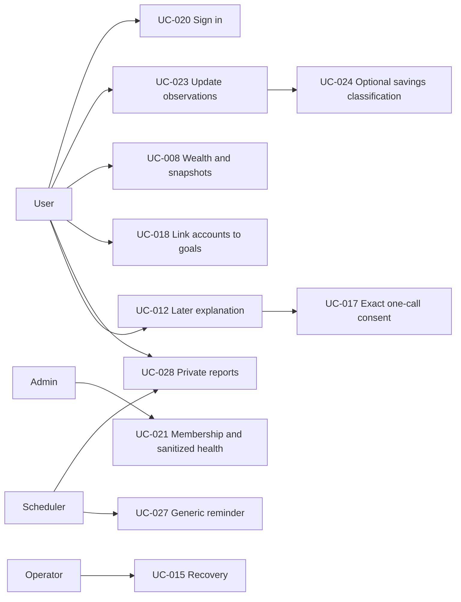

# Finance Tracker — Use Cases

Status: Planned revised workflows. User, Admin and Operator are distinct actors; Scheduler, SMTP and later Gemini are supporting actors. PostgreSQL/ORM are internal components. Prototype authentication is a synthetic-only subset of UC-020; UC-002/023 provide its account/card workflow. M-007 gates all real-user/sensitive-data use.

## UC-001 — Configure and launch

- **Primary actor:** User / Operator
- **Trigger:** Start application.
- **Preconditions:** Approved local environment.
- **Requirements:** FR-001, FR-002, FR-032.
- **Main success flow:** Validate configuration and the prototype/release mode; choose or reuse permitted reporting settings; open the authenticated UI.
- **Alternatives / exceptions:** Invalid configuration gives redacted errors; external credentials are optional.
- **Postconditions:** Authorized result is available with its provenance; failed/canceled writes leave prior data intact.

## UC-002 — Manage accounts and asset definitions

- **Primary actor:** User
- **Trigger:** Open Accounts.
- **Preconditions:** Authenticated owned workspace.
- **Requirements:** FR-003, FR-004.
- **Main success flow:** Create/rename an account or define an instrument with units; validate; show a readable card/list.
- **Alternatives / exceptions:** Reject cross-owner/reference misuse; archive preserves history.
- **Postconditions:** Authorized result is available with its provenance; failed/canceled writes leave prior data intact.

## UC-007 — Maintain manual prices

- **Primary actor:** User
- **Trigger:** Enter or revise a price.
- **Preconditions:** Owned non-base holding.
- **Requirements:** FR-005.
- **Main success flow:** Enter effective date and exact price; validate; save revision; refresh current valuation.
- **Alternatives / exceptions:** Reject future/nonfinite input; historical snapshots stay unchanged.
- **Postconditions:** Authorized result is available with its provenance; failed/canceled writes leave prior data intact.

## UC-008 — Review wealth and history

- **Primary actor:** User
- **Trigger:** Open Dashboard.
- **Preconditions:** Authenticated owned workspace.
- **Requirements:** FR-011, FR-012, FR-014, FR-015, FR-044, FR-050.
- **Main success flow:** Read coherent observations/prices; calculate qualified totals; display cards, composition or saved historical snapshots.
- **Alternatives / exceptions:** Empty and missing/stale states are explicit; no historical backfill.
- **Postconditions:** Authorized result is available with its provenance; failed/canceled writes leave prior data intact.

## UC-009 — Manage savings goals

- **Primary actor:** User
- **Trigger:** Create/edit/close goal.
- **Preconditions:** Currency configured.
- **Requirements:** FR-016.
- **Main success flow:** Enter target and date; validate; save; show linked-account progress.
- **Alternatives / exceptions:** Closure ends links without cash movement; overdue is labeled.
- **Postconditions:** Authorized result is available with its provenance; failed/canceled writes leave prior data intact.

## UC-011 — Review indicative monthly saving

- **Primary actor:** User
- **Trigger:** Open goal plan.
- **Preconditions:** Saved goal.
- **Requirements:** FR-019.
- **Main success flow:** Use local date and qualified linked values to calculate an indicative monthly saving.
- **Alternatives / exceptions:** Funded/overdue/incomplete states prevent misleading amounts.
- **Postconditions:** Authorized result is available with its provenance; failed/canceled writes leave prior data intact.

## UC-012 — Request Gemini explanation

- **Primary actor:** User
- **Trigger:** Choose explanation.
- **Preconditions:** Later integration configured.
- **Requirements:** FR-020, FR-021, FR-022, FR-023, FR-024.
- **Main success flow:** Build minimized computed summary; invoke UC-017; send approved payload once; display labeled untrusted text.
- **Alternatives / exceptions:** Cancel/stale approval makes no call; provider failure preserves core; no personalized security advice.
- **Postconditions:** Authorized result is available with its provenance; failed/canceled writes leave prior data intact.

## UC-015 — Back up or restore system

- **Primary actor:** Operator
- **Trigger:** Request maintenance.
- **Preconditions:** Separately authorized private operator access.
- **Requirements:** FR-029, FR-030.
- **Main success flow:** Create consistent PostgreSQL backup; validate candidate separately; confirm replacement; stop writers; make safety backup; restore and verify ownership, values and session/job safety.
- **Alternatives / exceptions:** Abort invalid restore without changing live data; rollback remains available.
- **Postconditions:** Authorized result is available with its provenance; failed/canceled writes leave prior data intact.

## UC-016 — Export own data

- **Primary actor:** User
- **Trigger:** Request CSV.
- **Preconditions:** Authenticated own records.
- **Requirements:** FR-031.
- **Main success flow:** Choose groups/period; read consistent owned records; serialize exact values and neutralize formula-like text.
- **Alternatives / exceptions:** No cross-owner data or credentials; not a recovery backup.
- **Postconditions:** Authorized result is available with its provenance; failed/canceled writes leave prior data intact.

## UC-017 — Approve exact Gemini context

- **Primary actor:** User
- **Trigger:** Prepared AI question.
- **Preconditions:** Later summary available.
- **Requirements:** FR-024.
- **Main success flow:** Preview exact minimized context and question; edit/cancel or approve a single request.
- **Alternatives / exceptions:** Any context/question change invalidates approval; consumed approval cannot replay.
- **Postconditions:** Authorized result is available with its provenance; failed/canceled writes leave prior data intact.

## UC-018 — Link accounts to goals

- **Primary actor:** User
- **Trigger:** Choose goal accounts.
- **Preconditions:** Owned active goal/accounts.
- **Requirements:** FR-018, FR-048.
- **Main success flow:** Show each account value/freshness; assign accounts; enforce one active goal per account; recompute progress.
- **Alternatives / exceptions:** Concurrent duplicate funding fails; withdrawal remains allowed.
- **Postconditions:** Authorized result is available with its provenance; failed/canceled writes leave prior data intact.

## UC-019 — Invite a member

- **Primary actor:** Admin
- **Trigger:** Create invitation.
- **Preconditions:** MFA-authorized Admin.
- **Requirements:** FR-033.
- **Main success flow:** Enter intended email; issue expiring single-use invitation; recipient proves possession and enrolls.
- **Alternatives / exceptions:** Used/revoked/expired token fails; no public signup or financial access.
- **Postconditions:** Authorized result is available with its provenance; failed/canceled writes leave prior data intact.

## UC-020 — Sign in, sign out or recover

- **Primary actor:** User / Admin
- **Trigger:** Open login or recovery.
- **Preconditions:** Provisioned synthetic identity or invited release account.
- **Requirements:** FR-034.
- **Main success flow:** Authenticate through standard Django foundations; enforce role/MFA state; create secure session or send reset to existing verified email; sign-out revokes access.
- **Alternatives / exceptions:** Generic failure/reset response; suspension/recovery invalidates sessions; prototype does not claim full release controls.
- **Postconditions:** Authorized result is available with its provenance; failed/canceled writes leave prior data intact.

## UC-021 — Administer users and health

- **Primary actor:** Admin
- **Trigger:** Open administration.
- **Preconditions:** Authenticated MFA-approved Admin.
- **Requirements:** FR-035, FR-045, FR-051.
- **Main success flow:** Inspect membership and sanitized health; invite/suspend permitted identities.
- **Alternatives / exceptions:** No financial records, arbitrary password setting, impersonation or takeover via email/role changes.
- **Postconditions:** Authorized result is available with its provenance; failed/canceled writes leave prior data intact.

## UC-022 — Access an owned financial resource

- **Primary actor:** User
- **Trigger:** Request financial page/action/export.
- **Preconditions:** Authenticated active User.
- **Requirements:** FR-036.
- **Main success flow:** Derive owner on server; authorize object and related references; return only owned results.
- **Alternatives / exceptions:** Cross-owner or Admin request fails without financial content or mutation.
- **Postconditions:** Authorized result is available with its provenance; failed/canceled writes leave prior data intact.

## UC-023 — Update or revise observations

- **Primary actor:** User
- **Trigger:** Enter current account information.
- **Preconditions:** Owned account.
- **Requirements:** FR-037, FR-049.
- **Main success flow:** Enter balances/quantities and dates; optionally include UC-024; validate and save one update batch; refresh cards.
- **Alternatives / exceptions:** Opening is baseline; rollback/replay/conflicting version preserves prior data; revisions retain originals.
- **Postconditions:** Authorized result is available with its provenance; failed/canceled writes leave prior data intact.

## UC-024 — Annotate savings movements

- **Primary actor:** User
- **Trigger:** Classify savings in an update.
- **Preconditions:** Current update intent.
- **Requirements:** FR-038.
- **Main success flow:** Enter contributions/withdrawals/internal movements with dates and amounts; save with observations once.
- **Alternatives / exceptions:** Skipping classification is allowed; unknown amount/completeness limits attribution; never add annotated amount again.
- **Postconditions:** Authorized result is available with its provenance; failed/canceled writes leave prior data intact.

## UC-025 — Review change attribution

- **Primary actor:** User
- **Trigger:** Compare two snapshots.
- **Preconditions:** Owned endpoints.
- **Requirements:** FR-039.
- **Main success flow:** Show recorded wealth change and reported movements; check coverage, valuation and interval-completeness assertion; show supported residual or unknown.
- **Alternatives / exceptions:** No entries does not mean zero flows; changed source revisions invalidate confirmation; residual is not investment profit.
- **Postconditions:** Authorized result is available with its provenance; failed/canceled writes leave prior data intact.

## UC-026 — Review optional financial profile

- **Primary actor:** User
- **Trigger:** Open Profile.
- **Preconditions:** Authenticated User.
- **Requirements:** FR-040, FR-050.
- **Main success flow:** Enter monthly estimates or explicitly confirm unchanged information; save review date.
- **Alternatives / exceptions:** Omission does not block core/reports; estimates do not alter balances.
- **Postconditions:** Authorized result is available with its provenance; failed/canceled writes leave prior data intact.

## UC-027 — Configure schedule and receive reminder

- **Primary actor:** User / Scheduler
- **Trigger:** Enable schedule or due reminder.
- **Preconditions:** Verified email for sending.
- **Requirements:** FR-041, FR-042.
- **Main success flow:** Choose timezone/monthly occurrence; explicitly enable; runner claims due reminder and sends generic email outside financial transaction.
- **Alternatives / exceptions:** No financial details/token report access; disablement and SMTP ambiguity are respected.
- **Postconditions:** Authorized result is available with its provenance; failed/canceled writes leave prior data intact.

## UC-028 — Generate and view monthly report

- **Primary actor:** User / Scheduler
- **Trigger:** Report occurrence due.
- **Preconditions:** Enabled schedule.
- **Requirements:** FR-043, FR-044, FR-050.
- **Main success flow:** Claim occurrence; build coherent previous-local-month report using available data; save immutable private revision; user signs in to view.
- **Alternatives / exceptions:** Stale/absent profile and email failure do not block; retries do not duplicate; regenerate as new revision.
- **Postconditions:** Authorized result is available with its provenance; failed/canceled writes leave prior data intact.

## UC-029 — Verify and operate release

- **Primary actor:** Operator
- **Trigger:** Authorized release work.
- **Preconditions:** Reviewed task and explicit operation permission.
- **Requirements:** FR-046, FR-047.
- **Main success flow:** Run CI/synthetic checks; verify Pi/CasaOS/Compose/Tunnel compatibility; rehearse private deployment/recovery/rollback; record owner acceptance.
- **Alternatives / exceptions:** Prototype/full foundation does not permit real data; deployment still needs separate permission.
- **Postconditions:** Authorized result is available with its provenance; failed/canceled writes leave prior data intact.

## Historical use cases

| ID | Original concept | Status |
|---|---|---|
| UC-003 | Record holding transactions | Deferred/superseded; original specification retained at baseline 5052b5b. |
| UC-004 | Record income or expense | Deferred/superseded; original specification retained at baseline 5052b5b. |
| UC-005 | Correct/delete financial transactions | Deferred/superseded; original specification retained at baseline 5052b5b. |
| UC-006 | Transfer cash using postings | Deferred/superseded; original specification retained at baseline 5052b5b. |
| UC-010 | Reserve savings | Deferred/superseded; original specification retained at baseline 5052b5b. |
| UC-013 | Configure Telegram reporting | Deferred/superseded; original specification retained at baseline 5052b5b. |
| UC-014 | Receive Telegram financial messages | Deferred/superseded; original specification retained at baseline 5052b5b. |

## Editable interaction diagram

This Mermaid diagram describes interaction flows, not formal UML notation. Actor permissions are specified above; Admin has no path to private wealth/reports. Diagram sources are editable; rendering is validated separately when a renderer is available.
